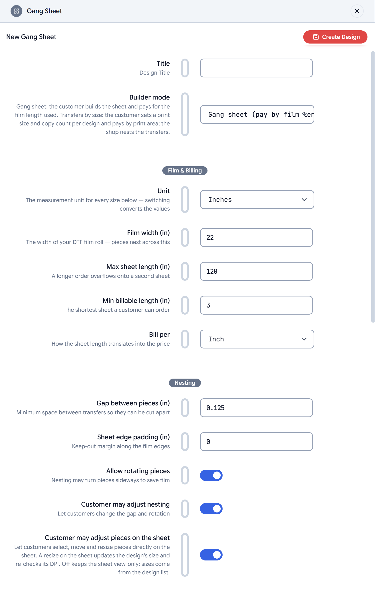

A Gang Sheet design is configuration, not a canvas: it tells the builder
what film the shop runs, how the sheet is billed, how pieces are packed
and what customers may do to their artwork. Open the design in the
dashboard to edit it; the panel is split into the sections below.

<Frame>
    
</Frame>

<Note>
    Projects take a **snapshot** of these settings when a customer starts
    building. Changing a setting affects new projects only — a sheet a
    customer saved on 22" film stays on 22" film when they resume it.
</Note>

## Builder mode

| Setting | What it does | Default |
| --- | --- | --- |
| **Builder mode** | *Gang sheet* — the customer builds the sheet and pays for the film length used. *Transfers by size* — the customer sets a print size and copy count per design and pays by print area; the shop nests the transfers (the customer never sees a sheet). | Gang sheet |

Most of the settings below apply to both modes. Transfers by size hides
the ones that only make sense for a customer-built sheet (billing
increment, customer nesting), and prices by area instead of length — see
[Pricing](/gangsheet/pricing).

## Film and billing

| Setting | What it does | Default |
| --- | --- | --- |
| **Unit** | The measurement unit for every size on this panel and in the builder. Switching converts the values. | Inches |
| **Film width** | The width of the film roll. Pieces nest across this. | 22 in |
| **Max sheet length** | The longest sheet one order can use. A bigger order overflows onto a second sheet, which the customer sees as *Sheet 2*. | 120 in |
| **Min billable length** | The shortest sheet a customer can order. A pack shorter than this is padded to it, and the summary shows the padding as free length. | 3 in |
| **Bill per** | How the used length turns into the number sent to your store: per inch, per foot (or per centimeter for metric units), or fixed sheet lengths. The used length is rounded **up** to the next increment, or with fixed sheet lengths to the next of your **Sheet lengths**. | Inch |
| **Sheet lengths** | Lengths the customer can pick in the builder's summary, separated by commas: `24, 36, 60, 120`. With *Fixed sheet lengths* these are the only lengths sold, and the longest one is the longest sheet: a bigger order starts another sheet. With any other **Bill per** they are quick picks. | — |
| **Customer may enter a length** | Lets the customer type their own sheet length between the min and max length, rounded up to the billing increment. With it on, *Fixed sheet lengths* sells any whole inch or centimeter and the sheet lengths are only quick picks. | Off |

A length the customer picks is a **minimum**. The sheet is drawn at that
length and billed for it, and the summary shows the empty part as length
they are already paying for. If the designs need more film, the sheet grows
to what they need (the next sheet length on fixed sheet lengths) and the
summary says so. Without sheet lengths or typed lengths, the builder has no
length picker and the sheet always fits the designs.

## Nesting

| Setting | What it does | Default |
| --- | --- | --- |
| **Gap between pieces** | The minimum space the packer keeps between transfers so they can be cut apart. | 0.125 in |
| **Sheet edge padding** | A keep-out margin along the film edges. | 0 |
| **Allow rotating pieces** | The packer may turn pieces sideways to save film. Customers can switch this off per design in the list (*May rotate*). | On |
| **Customer may adjust nesting** | Shows the gap and rotation controls in the builder's top bar so customers can change them for their sheet. | On |
| **Customer may adjust pieces on the sheet** | Lets customers select, move and resize pieces directly on the sheet. A resize on the sheet updates the design's size in the list and re-checks its DPI. Off keeps the sheet view-only: every size comes from the design list, and the auto-nest owns the layout. | On |

<Tip>
    Leave **adjust pieces on the sheet** off if you want a layout you can
    trust blindly. The nest is validated on our servers before checkout
    either way, so a customer nudge that crosses the gap is caught, but a
    view-only sheet never needs the check.
</Tip>

## Quality

| Setting | What it does | Default |
| --- | --- | --- |
| **Minimum DPI** | Artwork below this resolution at its printed size is flagged in the list, on the sheet and in the summary, with the largest size that would pass. | 300 |
| **Low DPI blocks checkout** | On: Preview & Save stays disabled until every design meets the floor. Off: the warning shows but the customer can still order. | On |
| **Sharpen low-resolution uploads** | A design under the minimum DPI is accepted with a *sharpened for print* note instead of being flagged, and the print file carries a copy enlarged with AI to the minimum. It reaches down to a quarter of the minimum (75 dpi when the minimum is 300); a design below that is flagged as before. | Off |

Text pieces and SVG graphics from the gallery are vectors and never carry
a DPI verdict.

<Note>
    Sharpening is free: it is not billed as an AI image effect. It runs when
    you download the order's print file, keeps transparency and removed
    backgrounds, and works on each upload once however many copies are on
    the sheet. Each order has a limit that covers dozens of low-resolution
    uploads; past it, a design prints from its original pixels, as it
    would with the switch off. Projects keep the settings they started with,
    so turning it on applies to new orders.
</Note>

## Uploads

| Setting | What it does | Default |
| --- | --- | --- |
| **Remove background** | Shows a *Remove background* switch on each uploaded design. Uploads that are already transparent get the switch disabled — there is nothing to cut. | On |
| **Allow image effects** | Shows a *Halftone* switch per design, which screens the piece at print resolution. | On |
| **Welcome message** | The text shown in the empty design list before the first upload. Leave it blank for the default. | — |

## Design tools

Each switch adds a control to the builder. All are on by default.

| Setting | What the customer gets |
| --- | --- |
| **Add text** | An *Add Text* button: type text, pick a font from your typography catalog, set the height, colour and an optional outline. The text is placed as a vector and prints sharp at any size. |
| **Gallery** | A *Gallery* button listing the graphics folders this design's profiles allow. Raster graphics behave like uploads; SVG graphics stay vector. |
| **Search in the gallery** | A search box in the Gallery over the Print.App graphics library and your own graphics in the folders this design shows, whatever **Search covers** in your settings says. Off leaves only your folders. See [Gallery](/gangsheet/design-tools#gallery). |
| **Edit image** | An *Edit Image* button on uploaded and gallery rasters: rectangle or circle crop, brightness and contrast. |
| **Outline** | An *Outline* button that adds a keyline around a design — a white outline for dark garments, for instance. |

See [Design tools](/gangsheet/design-tools) for how each behaves.

## Sticker sheet

Turn a gang sheet into a print-and-cut sticker sheet: every design gets a
cut line following its shape.

| Setting | What it does | Default |
| --- | --- | --- |
| **Cut lines** | *Contour cut* draws a cut line around every design, the border width outside its artwork. Holes are filled, and parts of one design that sit close together join into one sticker (the letters of a word, a logo and its tagline). | Off |
| **Border width** | How far outside the artwork the cut line runs. | 0.125 in |
| **Bleed past the cut** | The border colour prints this much beyond the cut line, so a slightly-off cut never shows a bare edge. | 0.04 in |
| **Border colour** | The border's colour, as a hex value. White prints no ink on white vinyl. | `#ffffff` |
| **Cut line separation** | The spot colour name your cutting software looks for. `CutContour` suits Roland VersaWorks and most RIPs. | `CutContour` |

Each design's box on the sheet grows by the border and the bleed, so the
**Gap between pieces** is the space between neighbouring cut lines' borders.
Set it to what your cutter needs between stickers. The **Outline** tool is
not offered on a sticker sheet: the border is the outline. Sticker sheets
are view-only on the canvas, with sizes set in the design list. See
[Sticker sheets](/gangsheet/output#sticker-sheets) for what the PDF holds.

## Pricing

Print.App does not price the sheet; your store does. These two fields
connect the builder to the product page.

| Setting | What it does | Default |
| --- | --- | --- |
| **Price target on the product page** | Where the billable value is sent while the customer designs. Empty disables the push. `po:dimensions` feeds the Print Options widget with the film width and used length. Any other value is a CSS selector of an input on your product page, which receives the billable length in your billing unit (or the sheet count for fixed sheets). In Transfers-by-size mode the **total copy count** is sent instead, to `po:quantity` or to the selector you name. | — |
| **Price display source** | Shows the product page's live price inside the builder. `po:price` reads the Print Options widget's total; otherwise a CSS selector of the theme's price element. Empty hides the price in the builder. | — |

[Pricing](/gangsheet/pricing) walks through each path with numbers.

## Finished gang sheets

Some customers, often other print shops, already have a print-ready gang
sheet and only want to upload it. Those uploads go through
[Filecheck](https://filecheck.io), our file-check product, not the builder.
This section is hidden in Transfers-by-size mode.

**Set up in Filecheck** opens the Filecheck dashboard with this panel's
**Film width**, **Max sheet length** and **Minimum DPI**. Once you sign in
(or create an account), Filecheck builds a *DTF gang sheet* workflow from
them and opens product mapping, so you can pick the product customers
upload finished sheets to:

- One PNG, TIFF or PDF per order.
- Resolution is measured across the film width, so a sheet of any length
  is judged at your minimum DPI. With **Low DPI blocks checkout** off, a low
  resolution is a warning instead of a rejection.
- Nothing is changed automatically: no upscaling and no background removal
  on the customer's sheet.

Clicking it again with the same settings reuses that workflow; other
settings make another. Filecheck does not yet check that the background is
transparent or that the sheet is within your maximum length. The upload
instructions ask the customer for both.
