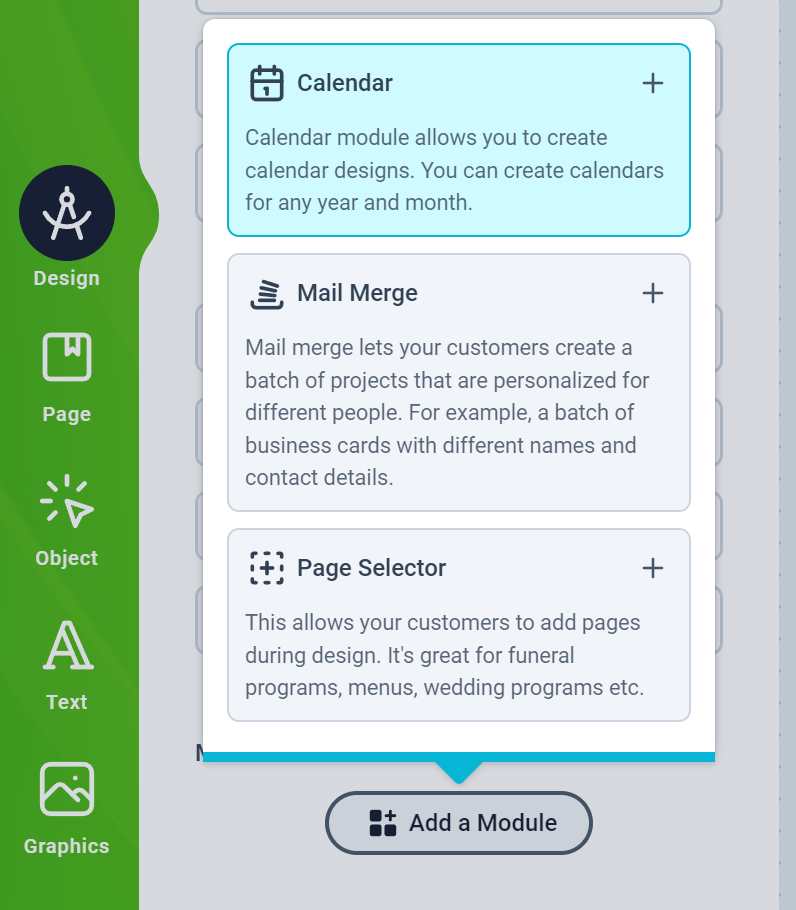
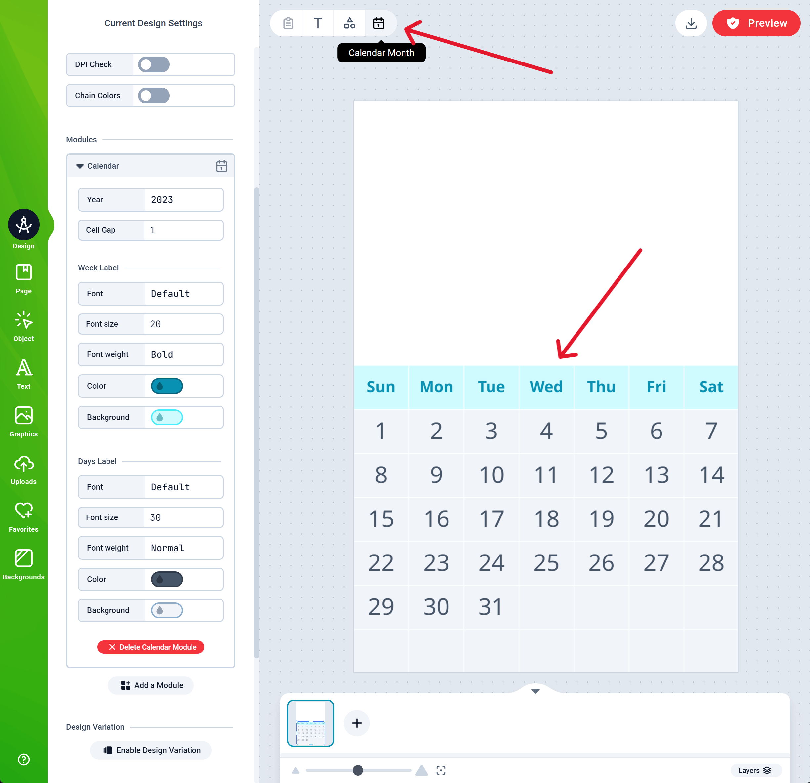
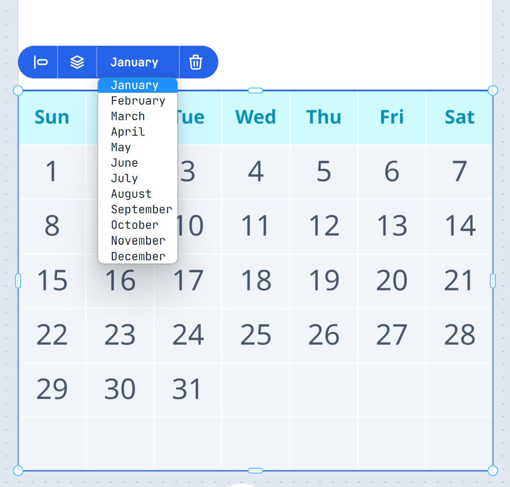
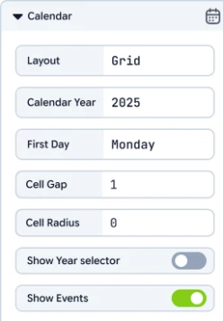
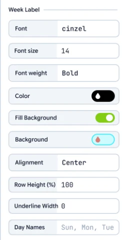
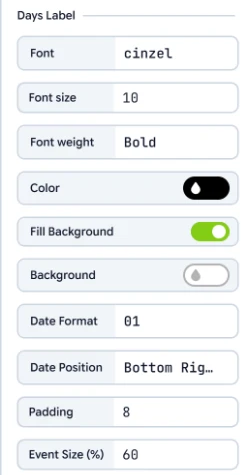
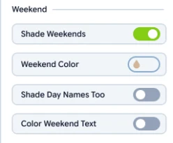
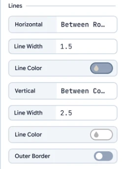
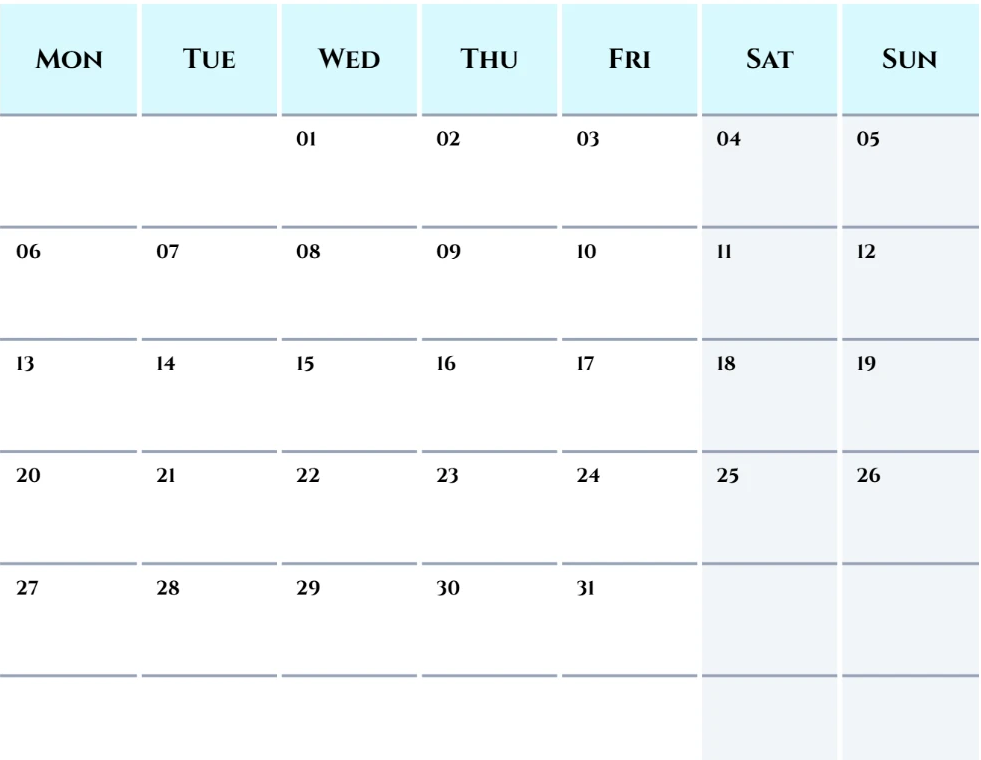
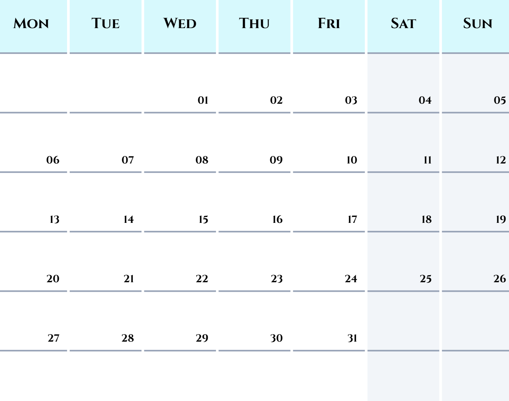

The Calendar module generates calendar months and styles them for you. Add as many months as you need, one per page or several on one page, and place them anywhere in your design.

<Note>
The layouts and most of the styling options on this page (date position, lines, background switches, weekend text color and date format) are available in the PrintFX editor. The classic editor draws the standard grid.
</Note>

## Add the Calendar module

To get started, load a Design or open one for edit from your [Admin Designs page](https://admin.print.app/designs).

<Steps>
    <Step title="Add the module">
        Click the Design tab on the left panel, click the `Add Module` button and choose Calendar from the list.
        
    </Step>
    <Step title="Add a month">
        Once the module is added, a button to add a calendar month appears on the top menubar. Click it whenever you need a month, and it's placed on your canvas.
        <Frame>
            
        </Frame>
    </Step>
    <Step title="Pick the month">
        To change a month, select it and choose the month in the context menu.
        <Frame>
            
        </Frame>
    </Step>
    <Step title="Style it">
        Choose a layout and style the calendar in the module's settings on the left (see [Settings](#settings) below). Changes apply to every month in the design.
    </Step>
</Steps>

## Layouts

| Layout | What it looks like | Events |
| --- | --- | --- |
| **Grid** | The classic month page: day names over seven columns of weeks. The grid always has six week rows, so every month takes the same space; rows a month doesn't need stay empty. | Printed in the date's cell |
| **Strip** | The month in one row: day names over dates, one column per day, stretched across the width. Suits minimalist wall calendars and desk pads. | A dot under the date |
| **List** | One row per day: day name, date, and a notes column. Suits family planners and write-in calendars. | Full names in the notes column |

When you switch layout, each month is re-fitted on its page, since a strip is wide and a list is tall.

## Settings

The settings are grouped into the sections below. Options marked *(Grid)* only appear when the layout is Grid.

### General

-   **Layout** - Grid, Strip or List (see [Layouts](#layouts)).
-   **Calendar Year** - The year the months are drawn for.
-   **First Day** - The day each week starts on in the Grid.
-   **Cell Gap** - The space between cells. Set it to 0 for cells that touch.
-   **Cell Radius** - Rounds the corners of the cell backgrounds.
-   **Show Year selector** - Lets your customers change the year in the editor.
-   **Show Events** - Shows the Calendar Events button, where events (birthdays, holidays) are added to dates.

### Week Label

The day names (Mon, Tue, …).

-   **Font**, **Font size**, **Font weight** and **Color** - The day names' text style.
-   **Fill Background** and **Background** - Turn the day names' background off, or pick its color.
-   **Alignment** *(Grid)* - Left, Center or Right within each cell.
-   **Row Height (%)** *(Grid)* - The height of the day-name row as a percentage of a week row. 100 makes it as tall as a week; around 30 gives a slim header.
-   **Underline Width** *(Grid)* - Draws a line under each day name, for example a thick bar under bold headings. When it's above 0, an **Underline Color** setting appears. At 0, the horizontal [Lines](#lines-grid) settings apply under the day names instead.
-   **Day Names** - Your own names, comma separated, starting from Sunday: for example `SUN, MON, TUE, WED, THU, FRI, SAT` or `Sunday, Monday, …`. Keep them in Sunday-first order even when the week starts on Monday; the calendar reorders them.

### Days Label

The dates.

-   **Font**, **Font size**, **Font weight** and **Color** - The dates' text style.
-   **Fill Background** and **Background** - Turn the date cells' background off, or pick its color.
-   **Date Format** - `1` or `01` (two digits).
-   **Date Position** *(Grid)* - Where the date sits in its cell:
    -   **Center** - The date is centered, and the day's events are printed underneath it.
    -   **Top Left**, **Top Right**, **Bottom Left** or **Bottom Right** - The date sits in that corner at full size, and the day's events are centered along the opposite edge. A top-left date puts its events along the bottom of the cell.
-   **Padding** *(Grid)* - The distance between the cell edge and a corner date, an event, or a left/right-aligned day name.
-   **Event Size (%)** *(Grid, corner positions)* - The size of event names as a percentage of the date size. Long names shrink further to fit their cell.

### Weekend

-   **Shade Weekends** and **Weekend Color** - A background color for the Saturday and Sunday cells.
-   **Shade Day Names Too** - Also shades the Saturday and Sunday day names, so the whole weekend column is shaded.
-   **Color Weekend Text** and **Color** - A text color for weekend day names, dates and events. In the Grid, the weekend's lines take this color too.

### Lines (Grid)

Lines are drawn separately from the cell backgrounds, so you can combine them with backgrounds or turn the backgrounds off for a clean ruled look.

-   **Horizontal** - Lines across the calendar:
    -   **None**
    -   **Between Rows** - Unbroken lines under the day names and between the weeks.
    -   **Under Each Cell** - A line under every cell, broken at the cell gap. With a Cell Gap above 0 you get separate underlines per day.
-   **Vertical** - **None** or **Between Columns**.
-   **Line Width** and **Line Color** - Set separately for horizontal and vertical lines. A white vertical line over colored cells reads as a gap between the columns.
-   **Outer Border** - A frame around the calendar, using the horizontal and vertical line settings.

<Tip>
With both Fill Background switches off, the calendar is still selectable anywhere inside its box, not only on its lines and text.
</Tip>

## Example looks

<Frame caption="Top Left dates in the 01 format, lines Between Rows, white lines Between Columns, shaded weekends.">
    
</Frame>

<Frame caption="The same settings with Bottom Right dates.">
    
</Frame>

Some starting points:

| Look | Settings |
| --- | --- |
| Boxed month, dates in the corner | Date Position: Top Left, Date Format: 01, Horizontal: Between Rows, Vertical: Between Columns, Cell Gap: 0, Shade Weekends and Shade Day Names Too |
| Ruled month, dates on a line | Fill Background off (Week Label and Days Label), Cell Gap: 10, Horizontal: Under Each Cell, Underline Width: 4, Alignment: Right, Date Position: Bottom Right, Color Weekend Text |
| Classic grid | Date Position: Center, Fill Background on, Lines: None |

## Resizing a month

Dragging a **side handle** resizes the calendar's box: the cells are laid out again and the text keeps its size, so a wider list gives more room for notes. Dragging a **corner handle** scales the whole calendar, text included.
