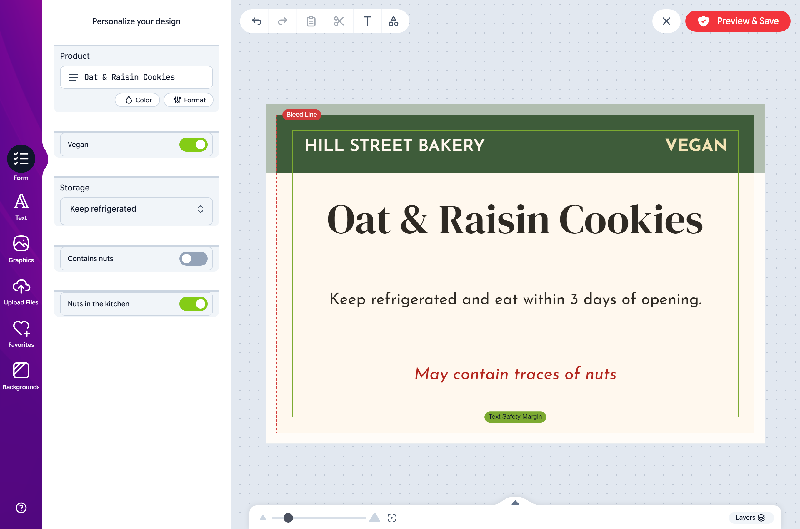
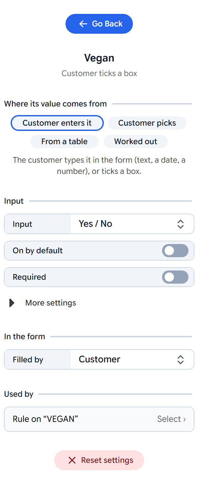
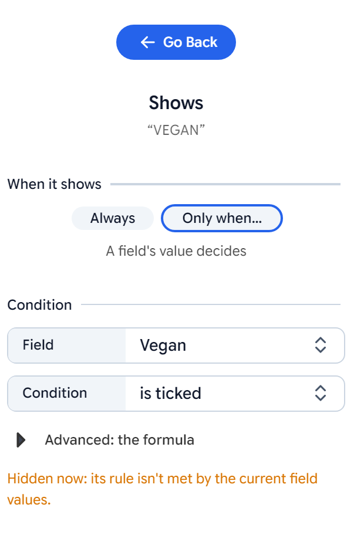
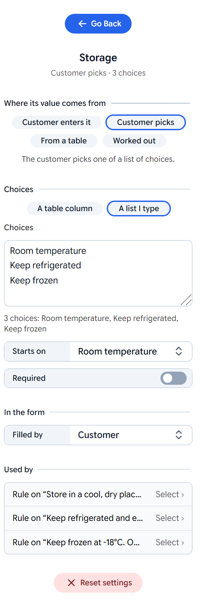
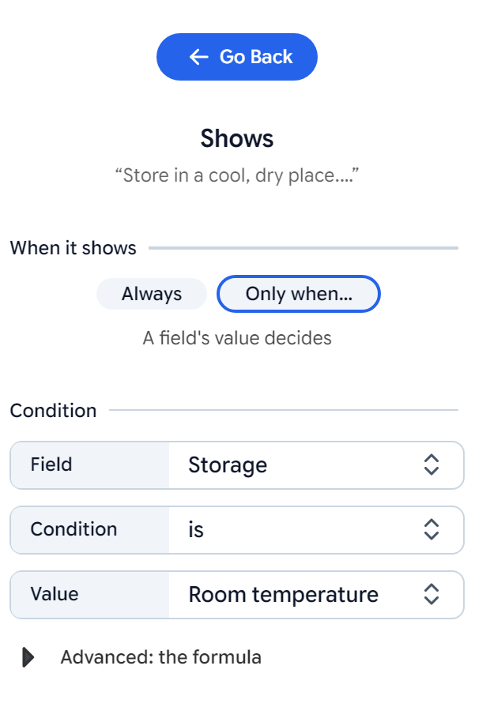
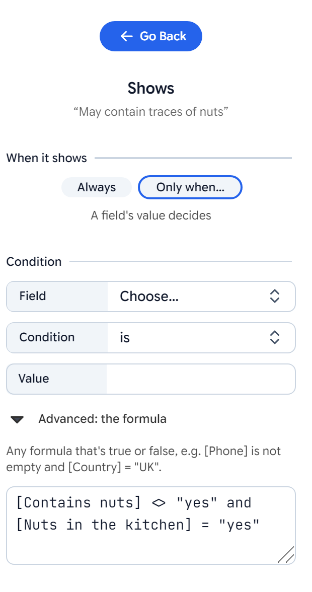
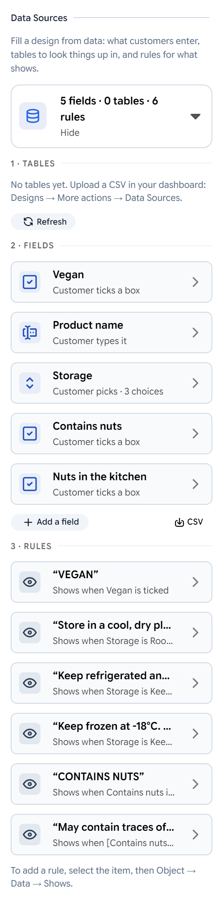
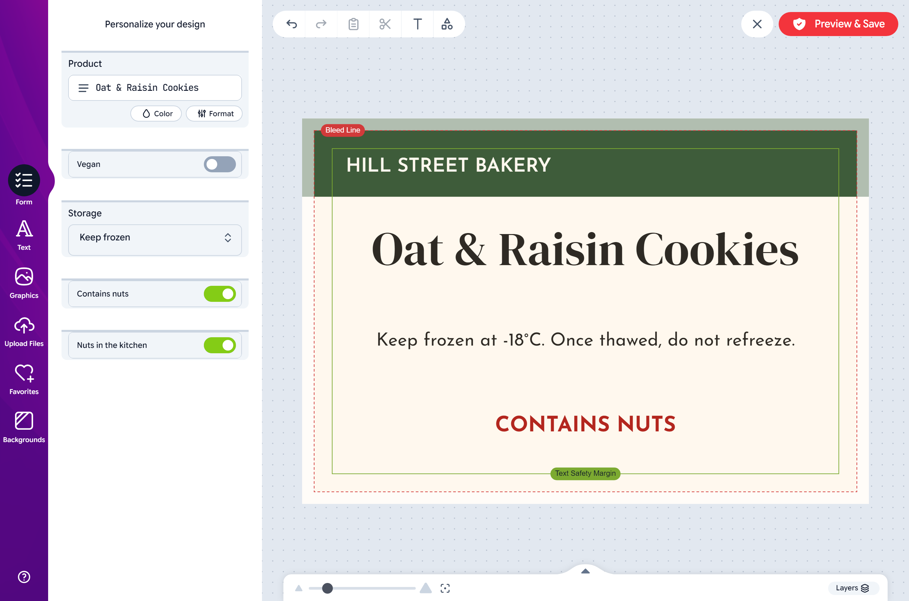

<Frame caption="One label for every product: the customer answers four questions, and only the lines that apply are printed.">
  
</Frame>

A bakery sells many products, but each box label needs different lines. With this label, the customer answers a few questions and it shows exactly what applies:

- **VEGAN** in the top corner, when they tick it;
- **the storage advice** for how the product is kept: one of three lines;
- **"CONTAINS NUTS"** when it does. If it doesn't but the kitchen uses nuts, it shows **"May contain traces of nuts"**; otherwise neither.

You'll use [show rules](/guides/designs/data-sources#connect-an-item-to-data) three ways: with a tick box, with a choice, and with a rule that combines two answers. It takes about 10 minutes in the PrintFx editor. If fields are new to you, start with the [food label tutorial](/tutorials/food-label).

<Steps>
  <Step title="Start the label">
    Create a design 90 × 60 mm, with 2 mm bleed and a 3 mm safe margin. Add the background, the brand name and a text `{Product name}` set to **Customer fills it in**, as in the [food label tutorial](/tutorials/food-label).
  </Step>

  <Step title="A badge that shows when it's ticked">
    1. Go to **Design → Data Sources** and click **Add a field**. Name it *Vegan*, choose **Customer enters it** and set **Input** to *Yes / No*.

       <Frame>
         
       </Frame>
    2. Add a text, `VEGAN`. Select it, then go to **Object → Data → Shows** and choose **Only when…**. Set **Field** to *Vegan* and **Condition** to *is ticked*.

       <Frame>
         
       </Frame>

    The badge disappears straight away. It comes back when the customer ticks **Vegan**.
  </Step>

  <Step title="Storage advice chosen from a list">
    1. Add a field, *Storage*, and choose **Customer picks**. Under **Choices**, choose **A list I type** and type one choice per line: *Room temperature*, *Keep refrigerated*, *Keep frozen*. Set **Starts on** to *Room temperature*.

       <Frame>
         
       </Frame>
    2. Add three texts, one for each choice:
       - *Store in a cool, dry place. Best eaten within 5 days.*
       - *Keep refrigerated and eat within 3 days of opening.*
       - *Keep frozen at -18°C. Once thawed, do not refreeze.*
    3. Give each text its rule: **Only when…**, **Field** *Storage*, **Condition** *is*, and the matching **Value**.

       <Frame>
         
       </Frame>
    4. Move the three texts into the same place. Only one rule can hold at a time, so only one line is ever on the label.

    <Tip>Once texts are stacked, the hidden ones can't be clicked on the design. To reach one, click its rule under **Design → Data Sources → Rules**: that selects the text and opens its **Shows** panel.</Tip>
  </Step>

  <Step title="A nut warning that depends on two answers">
    1. Add two fields, both **Customer enters it** with **Input** *Yes / No*:
       - *Contains nuts*;
       - *Nuts in the kitchen*, with **On by default** switched on, because most bakeries do use nuts.
    2. Add a text, `CONTAINS NUTS`. Give it the rule **Only when…** *Contains nuts* *is ticked*.
    3. Add a text, *May contain traces of nuts*, and put it in the same place. Give it the rule **Only when…** *Contains nuts* *isn't ticked*.
    4. Still in that rule, open **Advanced: the formula**. It reads `[Contains nuts] <> "yes"`. Add ` and [Nuts in the kitchen] = "yes"` to the end, so it reads:

       ```text wrap
       [Contains nuts] <> "yes" and [Nuts in the kitchen] = "yes"
       ```

       <Frame>
         
       </Frame>

    A ticked box is `"yes"`, `<>` means *isn't*, and `and` needs both parts to hold. Use `or` when either part is enough.
  </Step>

  <Step title="Check it as a customer">
    **Design → Data Sources** now lists 5 fields and 6 rules, each with what it does in words.

    <Frame>
      
    </Frame>

    Save, then open the design as a customer. Tick the boxes and change **Storage**: the label follows every answer.

    <Frame>
      
    </Frame>

    Hidden lines are left out of the print file too.
  </Step>
</Steps>

## Why it works

A show rule only decides whether its item is on the label, so you can stack several items in one place, as long as their rules can't hold at the same time. A rule reads the customer's answers, the same fields the form asks for, and can combine them with `and` and `or`.

<Note>A hidden item keeps its space: the items below it don't move up. Give each optional line its own place, or stack the alternatives in one place as this label does.</Note>

## Take it further

- **A line that shows only when something is typed:** use the condition *isn't empty*, as the batch line in the [food label tutorial](/tutorials/food-label) does.
- **Pictures and colours chosen by answers:** a field can also pick a frame's picture or an item's colour. See [Data Sources and fields](/guides/designs/data-sources#connect-an-item-to-data).
