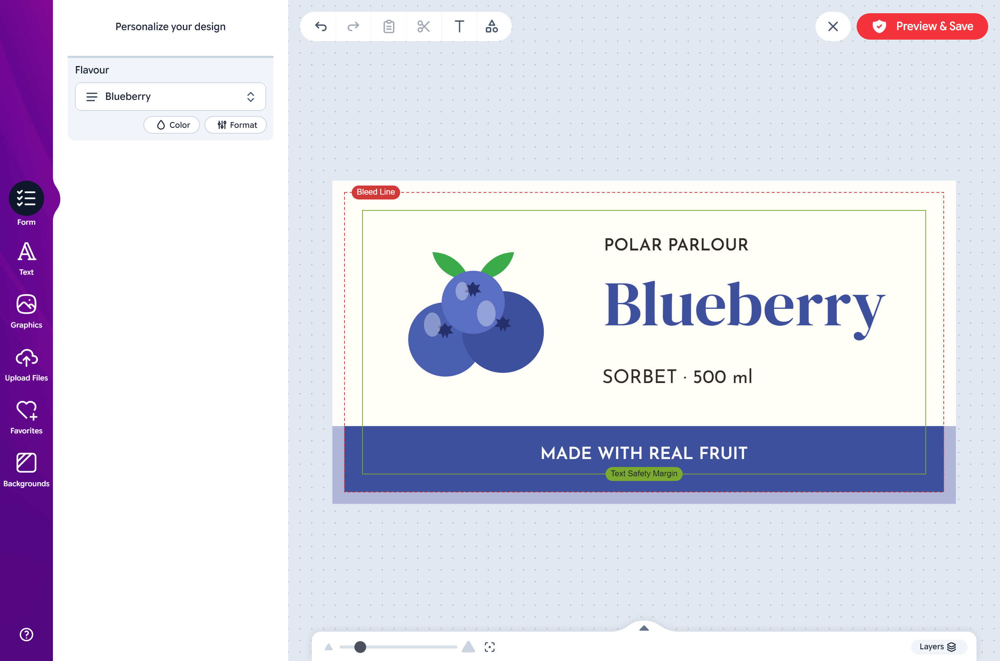
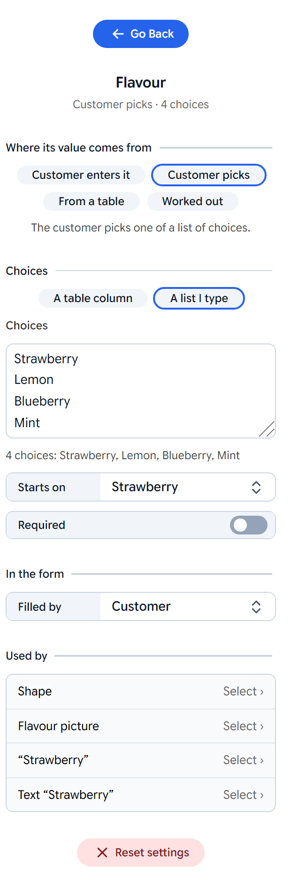
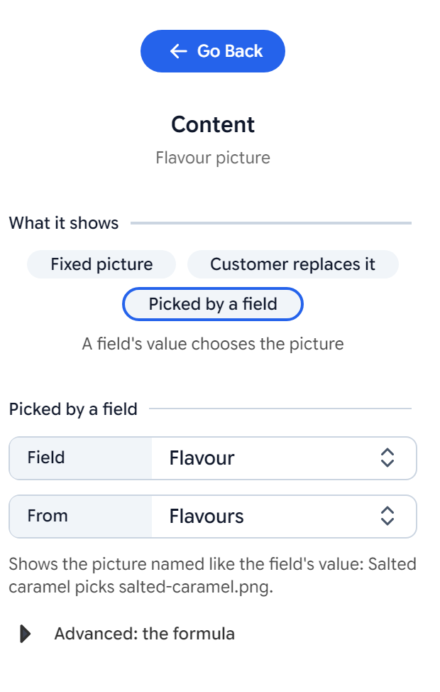
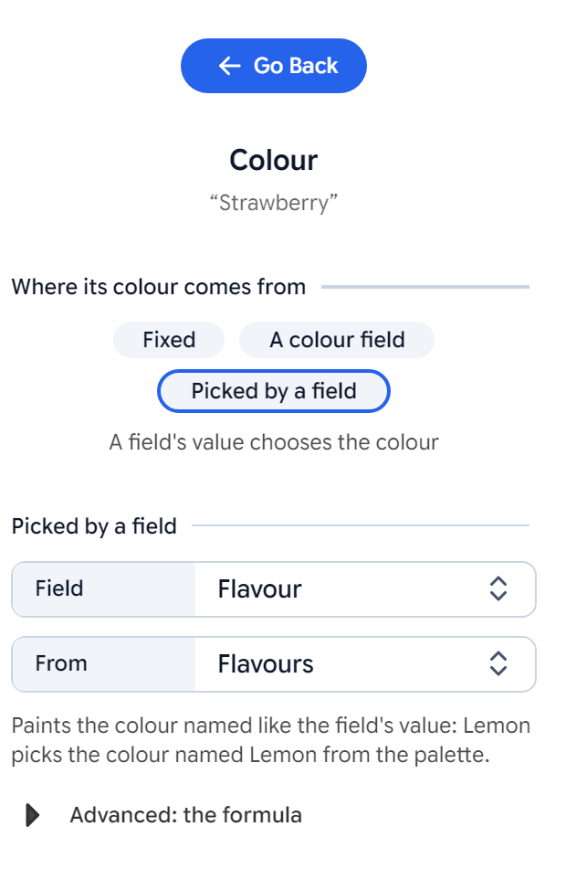
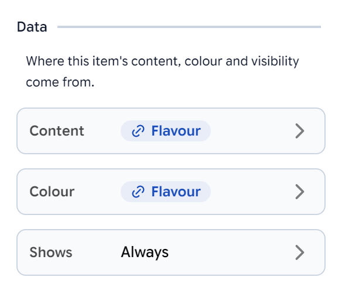
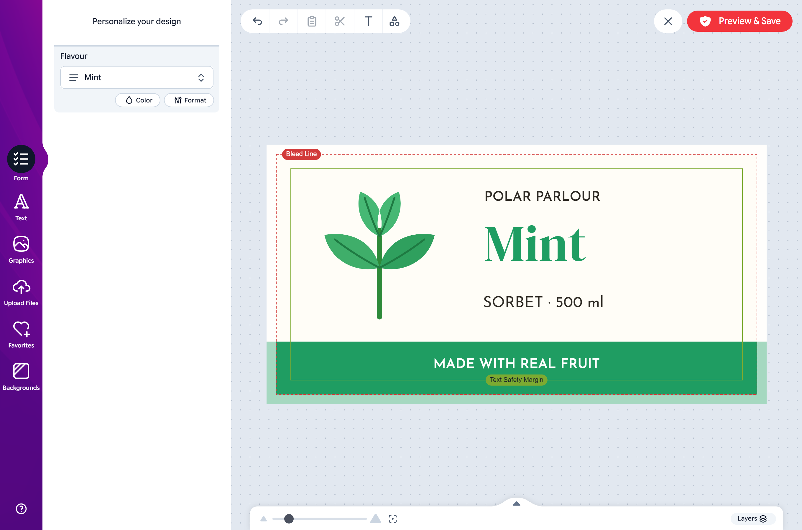

<Frame caption="One design, every flavour: the customer picks Blueberry, and the picture, the name and the colours follow.">
  
</Frame>

<Tip>[Try this label as a customer](https://create.print.app/pfx/index.html?engine=pfx&createpath=%2Fcid_xE3k3f%2Fdemo&layout=default). It opens in a demo, so nothing is saved.</Tip>

A shop selling a range of flavours, scents or colours doesn't need a design for each one. With this label, the customer picks a flavour from a list, and the label:

- shows that flavour's picture, from a graphics folder;
- writes the flavour's name;
- paints the name and the band in that flavour's colour, from a palette.

To add a flavour later, add a picture and a colour with its name. The design doesn't change.

You'll make a picture and a colour that are **picked by a field**. It takes about 15 minutes in the PrintFx editor. If fields are new to you, start with the [food label tutorial](/tutorials/food-label).

<Steps>
  <Step title="Name your pictures and colours after the flavours">
    The label finds each flavour's picture and colour by name, so start by naming them.

    1. In your dashboard, go to **Graphics**, create a folder called *Flavours*, and upload one picture for each flavour. Name each picture after its flavour: *Strawberry*, *Lemon*, *Blueberry*, *Mint*. A file called `strawberry.png` counts as *Strawberry*: upper and lower case don't matter, and a `-` or `_` counts as a space.
    2. Go to **Colors**, create a collection called *Flavours*, and add one colour for each flavour. Type its name in **Colour name**: *Strawberry*, *Lemon*, and so on.

    <Tip>Every flavour the customer can pick needs a picture and a colour with the same name.</Tip>
  </Step>

  <Step title="The flavour choice">
    1. Create a design 100 × 50 mm, with 2 mm bleed and a 3 mm safe margin. Add a text, `{Flavour}`, and set it to **Customer fills it in**.
    2. Go to **Design → Data Sources** and click **Flavour**. Choose **Customer picks** and then **A list I type**, and type the flavours, one per line. Set **Starts on** to *Strawberry*.

       <Frame>
         
       </Frame>
  </Step>

  <Step title="The picture follows the flavour">
    1. Add a picture frame where the flavour's picture goes. A circle works well.
    2. Select it, then go to **Object → Data → Content** and choose **Picked by a field**. Set **Field** to *Flavour* and **From** to *Flavours*.

       <Frame>
         
       </Frame>

    The frame now shows the picture named like the chosen flavour. Customers can't replace it with a photo of their own: the flavour decides.
  </Step>

  <Step title="The colours follow the flavour">
    1. Select the flavour's name, then go to **Object → Data → Colour** and choose **Picked by a field**. Set **Field** to *Flavour* and **From** to the *Flavours* palette.

       <Frame>
         
       </Frame>
    2. Add a band along the bottom, a rectangle, and give it the same colour setting.

    The **Data** section of each item now says where it gets its look from:

    <Frame>
      
    </Frame>
  </Step>

  <Step title="Check it as a customer">
    Save, then open the design as a customer and pick each flavour in turn. The picture, the name and both colours change together.

    <Frame>
      
    </Frame>
  </Step>
</Steps>

## Why it works

**Picked by a field** looks the field's value up by name. When the customer picks *Lemon*, the frame shows the picture named *Lemon* in the *Flavours* folder, and the name and band take the colour named *Lemon* in the *Flavours* palette. The design only says where to look, so the range can grow without touching it.

## Take it further

- **More about each flavour:** keep weights, ingredients or barcodes per flavour in a table, and look them up from the same choice. See [Data Sources and fields](/guides/designs/data-sources).
- **A colour the customer picks:** choose **A colour field** instead, and the customer picks the colour themselves from swatches.
- **Optional lines per flavour:** show or hide warnings with rules, as in the [bakery label tutorial](/tutorials/bakery-label).
