<Frame caption="What your customer gets: a short form, and a label that fills itself in.">
  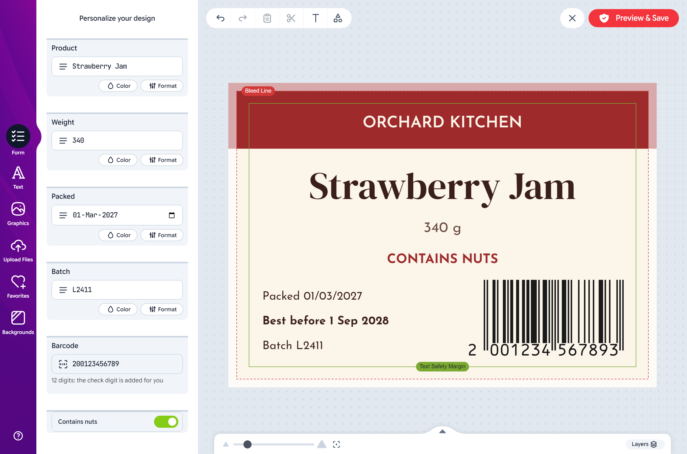
</Frame>

<Tip>[Try this label as a customer](https://create.print.app/pfx/index.html?engine=pfx&createpath=%2Fcid_B1mg3B%2Fdemo&layout=default). It opens in a demo, so nothing is saved.</Tip>

Your customer types the product name, weight, packing date, batch and barcode number, and ticks **Contains nuts** if it applies. The label does the rest:

- it works out the best-before date, 18 months after packing;
- it adds the barcode's check digit, and says so if a number is wrong;
- it shows the nuts warning only when the box is ticked;
- it drops the batch line when the batch is left empty.

You'll use [fields](/guides/designs/data-sources#fields), a [worked-out field](/guides/designs/data-sources#formulas), a barcode and two [show rules](/guides/designs/data-sources#connect-an-item-to-data). It takes about 15 minutes in the PrintFx editor.

<Steps>
  <Step title="Start the label">
    Create a design 100 × 70 mm, with 2 mm bleed and a 3 mm safe margin (see [Create a design](/guides/designs/create-a-design)). Add the background and the brand name as you normally would. Anything you don't connect to data stays exactly as you designed it.
  </Step>

  <Step title="Product name and weight">
    1. Add a text and type `{Product name}`. Add another and type `{Net weight} g`.
    2. Select each text, then go to **Object → Data → Content** and choose **Customer fills it in**. A word in curly brackets becomes a field. The rest of the text, like the "g", stays as you typed it.
    3. Go to **Design → Data Sources** and click **Product name**. Set **Starts with** to *Strawberry Jam*, and switch on **Required**.
    4. Click **Net weight**. Set **Input** to *Number* and **Starts with** to *340*.

    <Frame>
      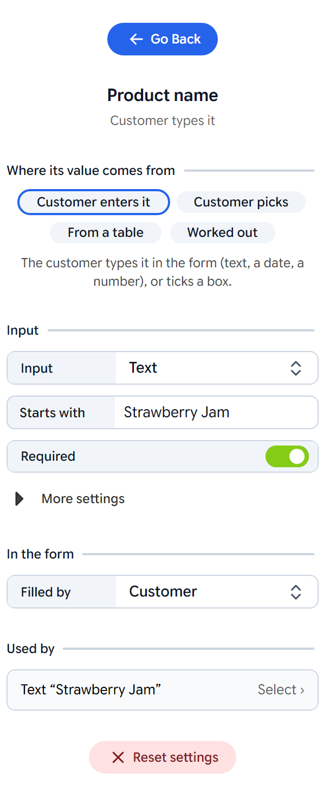
    </Frame>
  </Step>

  <Step title="The packing date">
    1. Add a text, `Packed {Packed on}`, and make it **Customer fills it in** as before.
    2. In **Data Sources**, click **Packed on**. Set **Input** to *Date* and **Date format** to `DD/MM/YYYY`.

    The customer gets a date picker, and the label prints the date in your format.

    <Frame>
      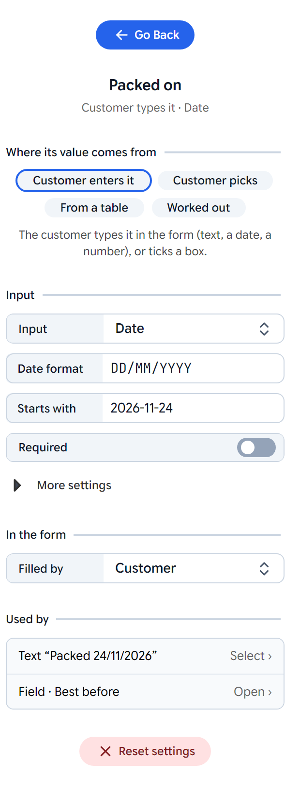
    </Frame>
  </Step>

  <Step title="The best-before date, worked out">
    1. Add a text, `Best before {Best before}`, and make it **Customer fills it in**.
    2. In **Data Sources**, click **Best before** and choose **Worked out**. Type this formula:

       ```text wrap
       format_date(date_add([Packed on], 18, "months"), "D MMM YYYY")
       ```

       `date_add` adds 18 months to the packing date, and `format_date` writes the result as *24 May 2028*. **Insert field** puts `[Packed on]` in for you.
    3. **Try it** shows the result for a sample date.

    The customer never sees this field. It changes whenever they change the packing date.

    <Frame>
      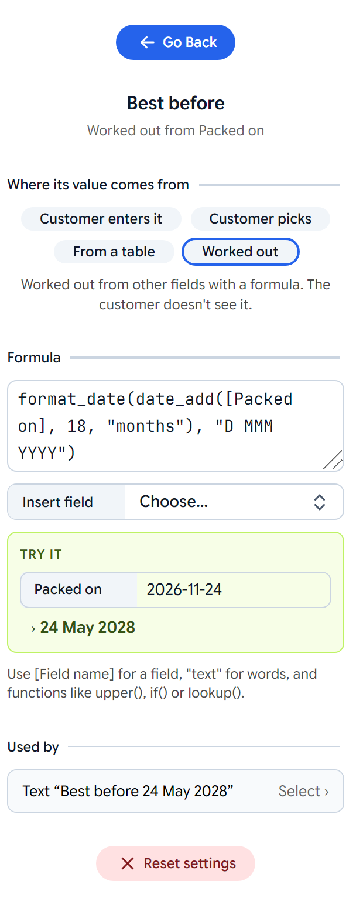
    </Frame>
  </Step>

  <Step title="The barcode">
    1. Click the QR code button in the top bar (**Add a QR code or barcode**), then choose the barcode.
    2. In **Object → Barcode**, keep **Type** at *EAN-13* and type a sample number. Type 12 digits: the 13th, the check digit, is worked out for you.

       <Frame>
         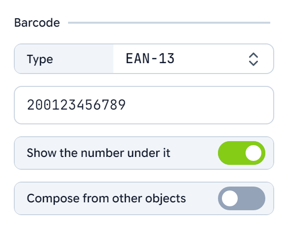
       </Frame>
    3. Still on the **Object** tab:
       - type *Barcode* in the name box at the top; it becomes the label in the customer's form;
       - under **Hint**, type *12 digits: the check digit is added for you*;
       - in **Data**, click **Content** and choose **Customer fills it in**.

       <Frame>
         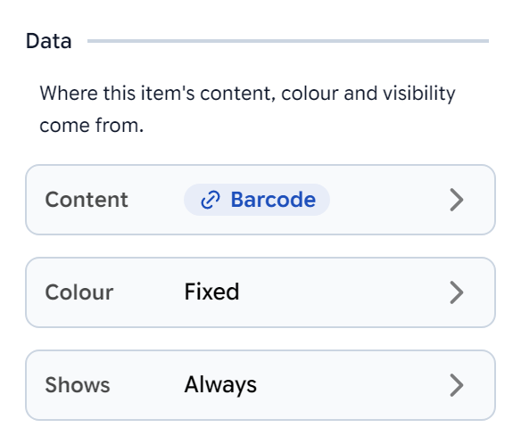
       </Frame>

    <Tip>Keep an EAN-13 at least 30 mm wide so shop scanners can read it.</Tip>
  </Step>

  <Step title="A warning that shows only when it's ticked">
    1. In **Data Sources**, click **Add a field** and name it *Contains nuts*. Choose **Customer enters it** and set **Input** to *Yes / No*.

       <Frame>
         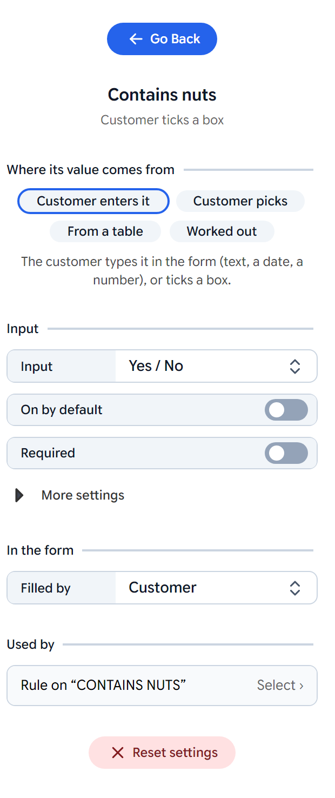
       </Frame>
    2. Add a text, `CONTAINS NUTS`. Select it, then go to **Object → Data → Shows** and choose **Only when…**. Set **Field** to *Contains nuts* and **Condition** to *is ticked*.

       <Frame>
         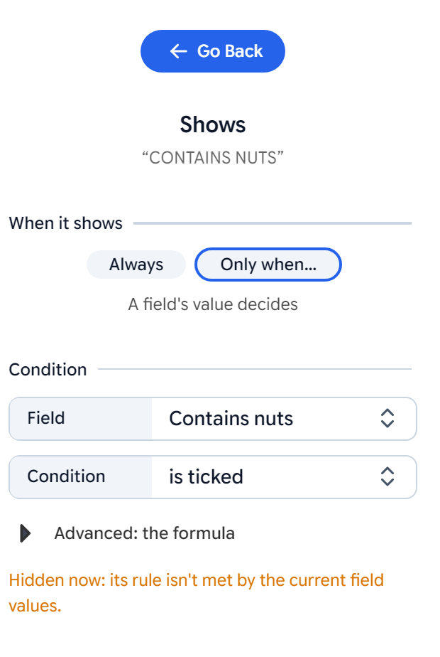
       </Frame>

    The warning disappears from the design straight away. "Hidden now" means its rule isn't met by the current values.
  </Step>

  <Step title="A batch line that disappears when it's empty">
    Add a text, `Batch {Batch}`, and make it **Customer fills it in**. Then go to **Shows → Only when…** and set **Field** to *Batch* and **Condition** to *isn't empty*.

    <Frame>
      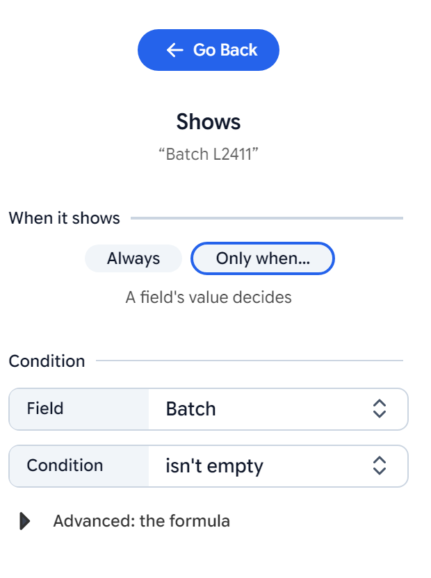
    </Frame>
  </Step>

  <Step title="Check it as a customer">
    **Design → Data Sources** now lists 7 fields and 2 rules.

    <Frame>
      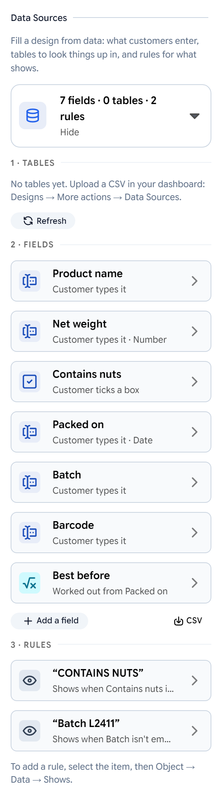
    </Frame>

    Save, then open the design as a customer and try each part:
    - change the packing date: the best-before date follows;
    - tick **Contains nuts**: the warning appears;
    - type a barcode number with a wrong last digit:

    <Frame>
      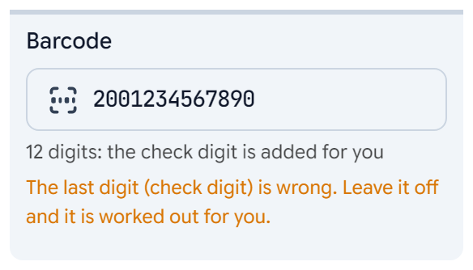
    </Frame>

    Hidden items are left out of the print file too.
  </Step>
</Steps>

## Why it works

Every word in curly brackets is a **field**: a named value the customer fills in once, used wherever the design needs it. A **worked-out field** is a formula over other fields, so the best-before date can never disagree with the packing date. A **show rule** is a condition on a field, so the warning is on the label exactly when it should be.

## Take it further

- **One label per flavour:** keep your flavours, weights and barcodes in a table, and look them up from a single **Flavour** choice. See [Data Sources and fields](/guides/designs/data-sources#example-an-office-on-a-business-card).
- **Long product names:** turn on **Shrink to Fit** for the name. See [Long values](/guides/designs/data-sources#long-values).
- **More formulas:** see [the full list](/guides/designs/data-sources#formulas).
