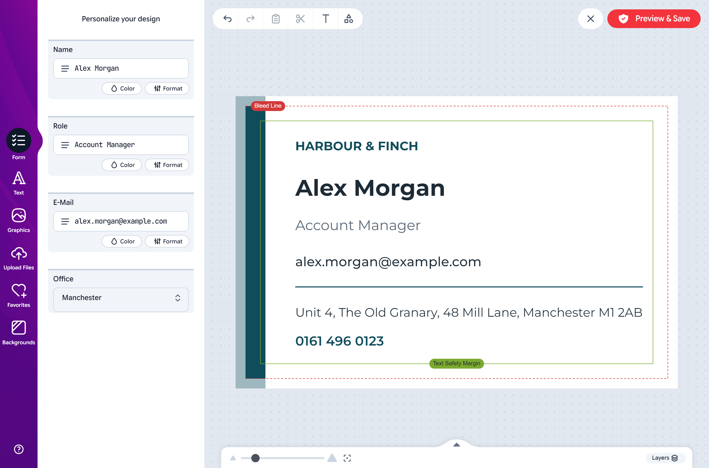
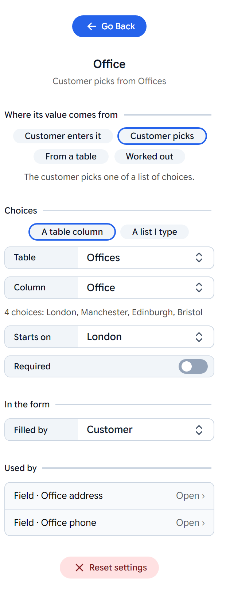
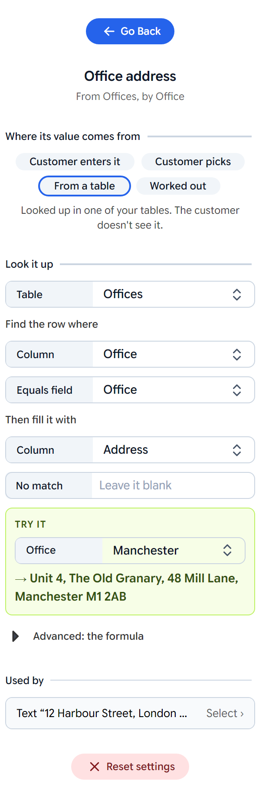
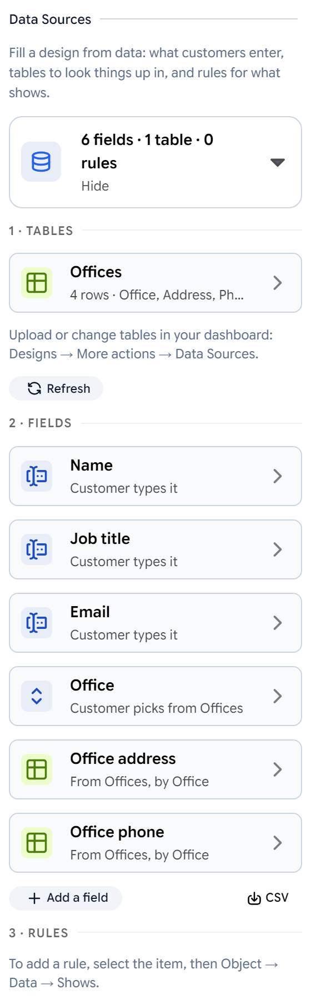
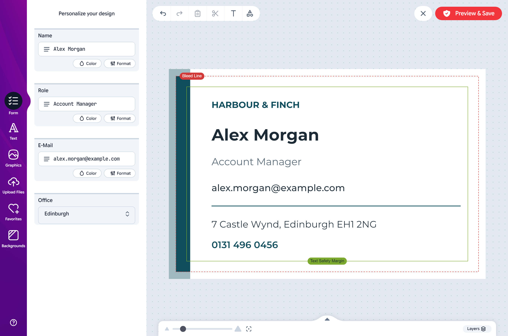
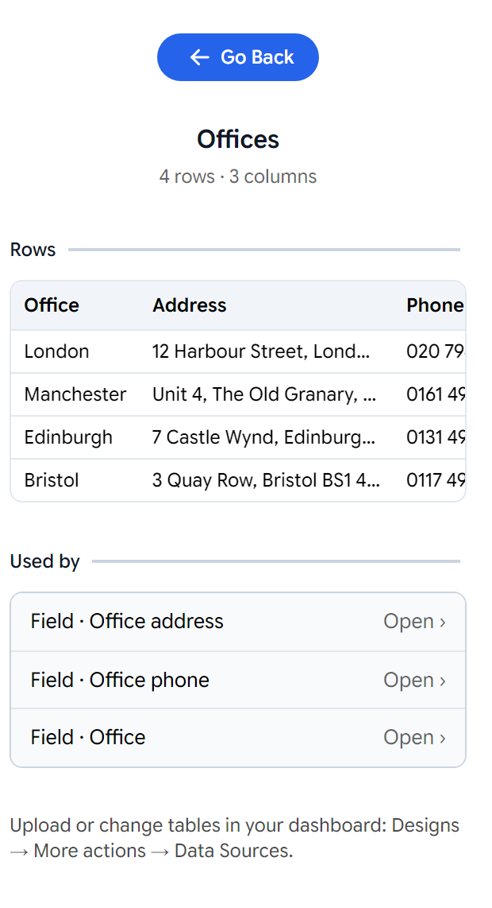

<Frame caption="The customer picks Manchester, and the card fills in the Manchester address and phone number.">
  
</Frame>

<Tip>[Try this card as a customer](https://create.print.app/pfx/index.html?engine=pfx&createpath=%2Fcid_HoM9Lm%2Fdemo&layout=default). It opens in a demo, so nothing is saved.</Tip>

Companies order business cards for staff in several offices. Typing the office address on every card is slow and gets it wrong. With this card, each person types their name, role and email, then picks their office from a list. The card fills in:

- the office's address;
- the office's phone number.

Both come from a spreadsheet you upload once. When an office moves, upload the spreadsheet again and every card reads the new address. The design doesn't change.

You'll upload a **table**, fill a dropdown from it, and make two fields **From a table**. It takes about 15 minutes. If fields are new to you, start with the [food label tutorial](/tutorials/food-label).

<Steps>
  <Step title="Upload the offices table">
    1. Make a spreadsheet with one row per office and save it as CSV, named `Offices.csv`:

       ```csv Offices.csv
       Office,Address,Phone
       London,"12 Harbour Street, London EC1A 4BX",020 7946 0018
       Manchester,"Unit 4, The Old Granary, 48 Mill Lane, Manchester M1 2AB",0161 496 0123
       Edinburgh,"7 Castle Wynd, Edinburgh EH1 2NG",0131 496 0456
       Bristol,"3 Quay Row, Bristol BS1 4QA",0117 496 0789
       ```

       The first row names the columns. The first column is what the card looks offices up by, so each office name appears only once.
    2. In your dashboard, go to **Designs → More actions → Data Sources** and click **Upload CSV**. Pick the file. The dashboard says *Offices.csv uploaded: 4 rows.*
  </Step>

  <Step title="Write the card">
    1. Create a design 85 × 55 mm, with 2 mm bleed and a 3 mm safe margin.
    2. Add the texts the customer fills in: `{Name}`, `{Job title}` and `{Email}`.
    3. Add a text for each detail that comes from the table: `{Office address}` and `{Office phone}`.

    Open **Design → Data Sources**. Your table is listed under **1 · Tables**, and each token is a field under **2 · Fields**. If you uploaded the table while the editor was open, click **Refresh**.
  </Step>

  <Step title="The office choice">
    1. Click **Add a field**. In **Name**, type *Office*, and choose **Customer picks**.
    2. Under **Choices**, choose **A table column**. Set **Table** to *Offices* and **Column** to *Office*.
    3. Set **Starts on** to *London*, then click **Create field**.

    <Frame>
      
    </Frame>

    The customer gets a dropdown of every office in the table. Add an office to the table and it joins the list.
  </Step>

  <Step title="Fill in the address and phone">
    1. Click **Office address** and choose **From a table**.
    2. Under **Look it up**, set **Table** to *Offices*.
    3. Under **Find the row where**, set **Column** to *Office* and **Equals field** to *Office*.
    4. Under **Then fill it with**, set **Column** to *Address*. Leave **No match** blank.
    5. Under **Try it**, pick an office to check the address it finds.

    <Frame>
      
    </Frame>

    Do the same for **Office phone**, with **Then fill it with** set to *Phone*.

    The customer doesn't see these two fields in the form: the office choice fills them. **Data Sources** now shows the whole set:

    <Frame>
      
    </Frame>
  </Step>

  <Step title="Make room for long addresses">
    Manchester's address is longer than the others. Select the address text and turn on **Typography → Shrink to Fit**. A long address then gets smaller to fit its box instead of running past the edge.
  </Step>

  <Step title="Check it as a customer">
    Save, then open the design as a customer. Under **Office**, pick each office in turn. The address and phone number change with it.

    <Frame>
      
    </Frame>
  </Step>
</Steps>

## Why it works

The dropdown's choices are the table's *Office* column, and the address and phone are looked up in the same table. So the list and the details can't drift apart. The lookup finds the row whose *Office* matches the customer's pick, ignoring upper and lower case and spaces at either end.

The table belongs to your account, not to one design. Every design that reads *Offices* sees the same rows. Click it in **Data Sources** to see them, with every field that reads it:

<Frame>
  
</Frame>
 To change an address, upload `Offices.csv` again with the same name: it replaces the old table, and every card reads the new rows.

## Take it further

- **More details per office:** add columns such as *Opening hours* or *Fax*, and a **From a table** field for each.
- **Phone numbers in one style:** make a **Worked out** field with `format_phone([Office phone], "GB", "international")` to print *+44 20 7946 0018*.
- **One card per row:** the same table can make a version of a design for every office. See [Design Variants](/guides/designs/variations/variation-datasource).
- **Every option:** [Data Sources and fields](/guides/designs/data-sources).
