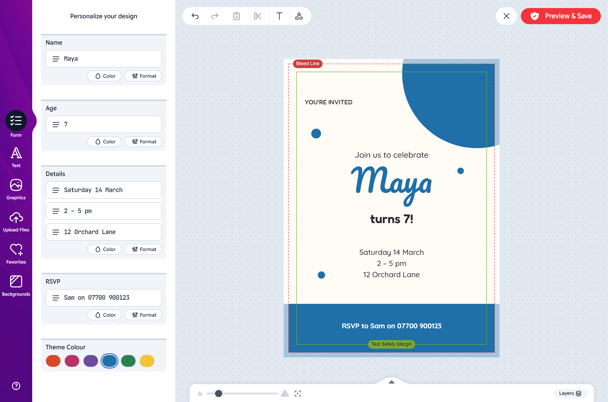
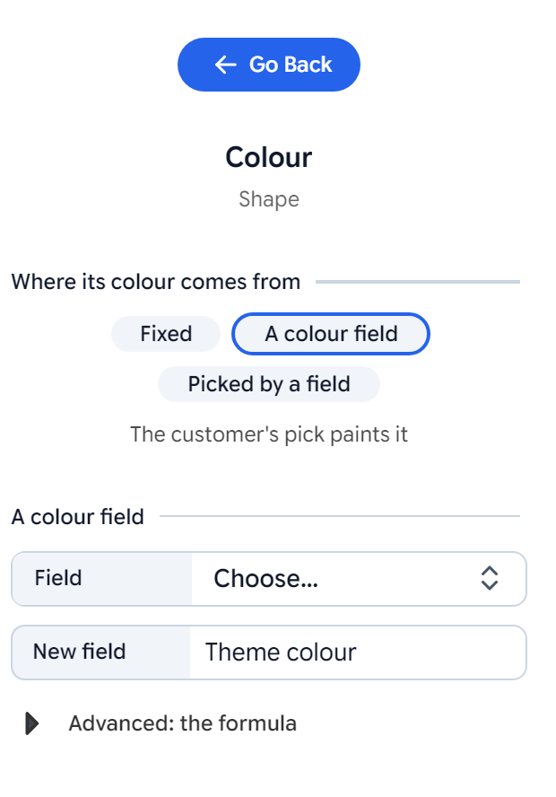
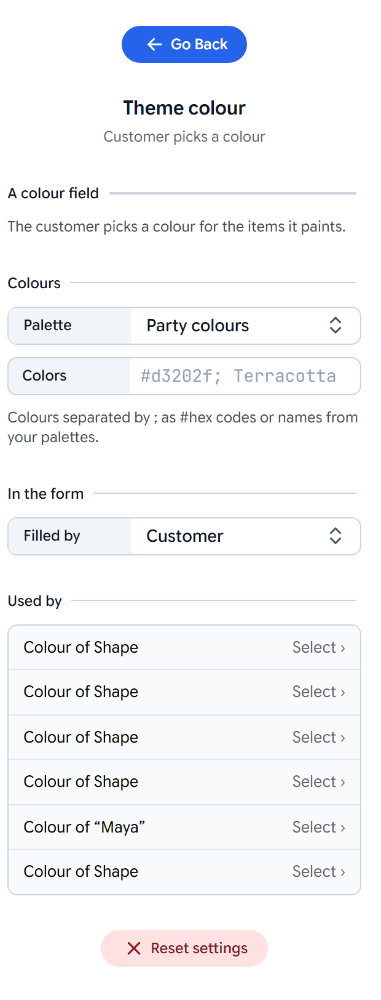
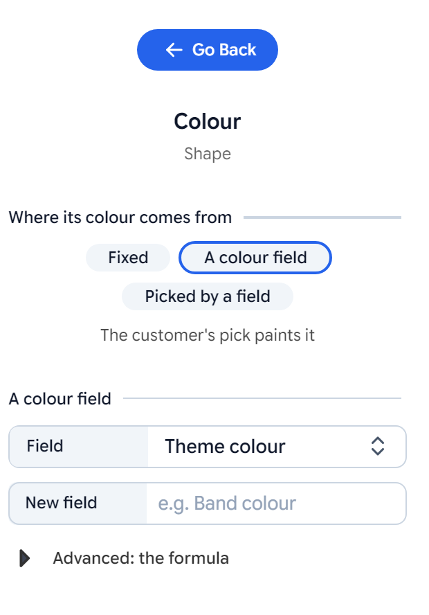
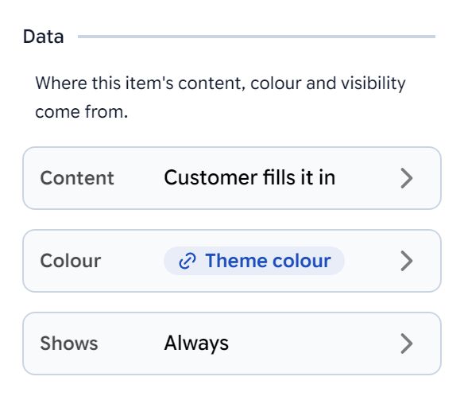
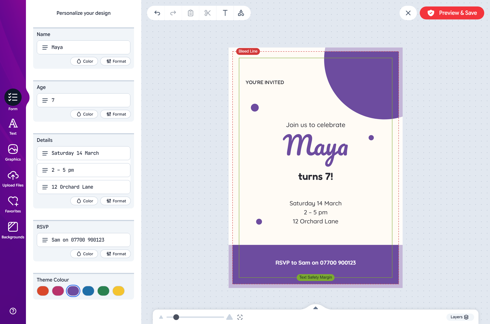
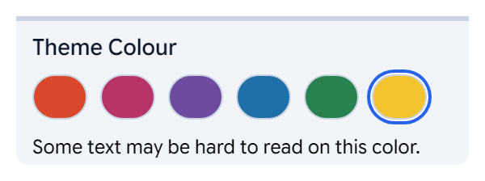

<Frame caption="The customer clicks a swatch, and every coloured part of the invitation follows: here, Ocean.">
  
</Frame>

<Tip>[Try this invitation as a customer](https://create.print.app/pfx/index.html?engine=pfx&createpath=%2Fcid_PNlGtT%2Fdemo&layout=default). It opens in a demo, so nothing is saved.</Tip>

Lots of products hang on one colour: the band on an invitation, the stripe on a business card, the panel on a label. You don't need a design for each colour. With this invitation, the customer clicks a swatch, and these all change to it at once:

- the big circle and the dots;
- the child's name;
- the RSVP band.

You choose which colours they can pick, by name, with the CMYK your press prints.

You'll make a **colour field** and let it paint six items. It takes about 15 minutes in the PrintFx editor. If fields are new to you, start with the [food label tutorial](/tutorials/food-label).

<Steps>
  <Step title="Make the colours customers can pick">
    1. In your dashboard, go to **Colors** and click **New Collection**. Call it *Party colours*.
    2. Click **Add New Color** for each colour, and type its name in **Colour name**: *Coral*, *Berry*, *Grape*, *Ocean*, *Leaf*, *Sunshine*. Customers see the name when they point at a swatch.

    <Tip>To print exact press colours, open each colour's **PDF-Color Override** (the CMYK button in the colour picker) and type its CMYK. The customer's pick prints in those values, not a conversion of the screen colour.</Tip>
  </Step>

  <Step title="Write the invitation">
    1. Create a design 5 × 7 in (127 × 178 mm) with 3 mm bleed.
    2. Add the texts, with a token for each detail the customer fills in: `{Name}`, `turns {Age}!`, `{Date}`, `{Time}`, `{Place}` and `RSVP to {RSVP}`.
    3. Add the shapes: a large circle off the top-right corner, three small dots, and a band along the bottom behind the RSVP line. Make the RSVP text white.

    Colour everything in your first colour (*Coral*) as you go. Until the customer picks, each item keeps the colour you gave it.
  </Step>

  <Step title="Create the colour field">
    A colour field starts from the first item it paints.

    1. Select the band, then go to **Object → Data → Colour** and choose **A colour field**.
    2. In **New field**, type *Theme colour* and press Enter.

       <Frame>
         
       </Frame>

    The band now takes the colour the customer picks for *Theme colour*.
  </Step>

  <Step title="Choose the colours it offers">
    Go to **Design → Data Sources** and click **Theme colour**. Set **Palette** to *Party colours*. Every colour in the collection becomes a swatch.

    <Frame>
      
    </Frame>

    To offer only some of them, list them in **Colors**, separated by `;`: `Coral; Ocean; Leaf`. A `#hex` code works there too.

    **Used by** lists every item the field paints. **Select ›** jumps to one.
  </Step>

  <Step title="Paint the rest">
    1. Select the big circle, go to **Object → Data → Colour**, choose **A colour field**, and set **Field** to *Theme colour*.

       <Frame>
         
       </Frame>
    2. Do the same for the three dots and the name.

    The name's **Data** section now says where it gets each part from: the customer types its words, and *Theme colour* paints it.

    <Frame>
      
    </Frame>
  </Step>

  <Step title="Check it as a customer">
    Save, then open the design as a customer and click the swatches under **Theme Colour**. The circle, the dots, the name and the band change together.

    <Frame>
      
    </Frame>

    Now pick *Sunshine*. Yellow is too pale for the white RSVP line and for the name on cream, and the form says so:

    <Frame>
      
    </Frame>

    The fix is in your collection. Leave out colours too pale for white text, or keep them for designs where text never sits on the colour.
  </Step>
</Steps>

## Why it works

A colour field holds one colour, and any number of items can take their colour from it. When the customer clicks a swatch, every item that uses the field is repainted with it. The swatches come from the collection, so a colour you add to *Party colours* in your dashboard becomes a swatch in every design whose field uses it. Each swatch carries its CMYK too, so the print file gets your press colour.

The warning compares each text with what's behind it. It shows when a pick leaves text and its background too close to read.

## Take it further

- **A theme by name:** let the customer pick *Summer* or *Winter* from a list, and paint items with the colour named like the choice. That's **Picked by a field**, as in the [flavour range tutorial](/tutorials/flavour-range).
- **Two colours:** make a second colour field, *Accent colour*, for the dots, with its own collection.
- **Fields and tables:** [Data Sources and fields](/guides/designs/data-sources) explains every option.
